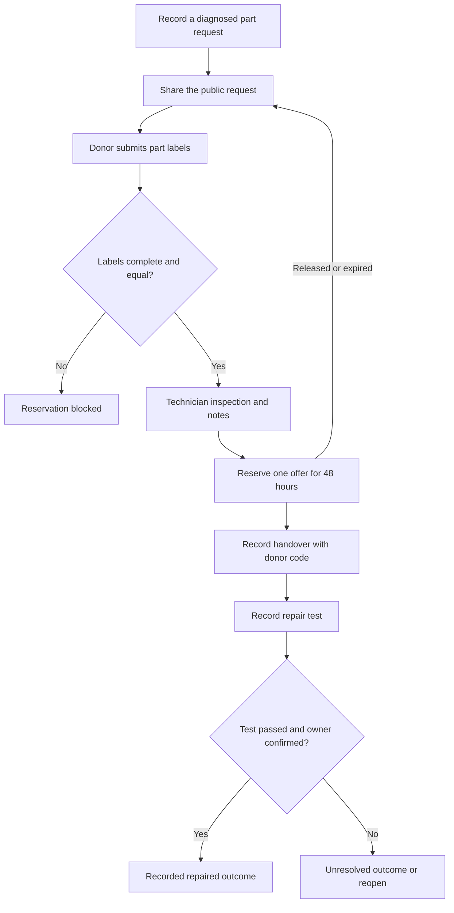
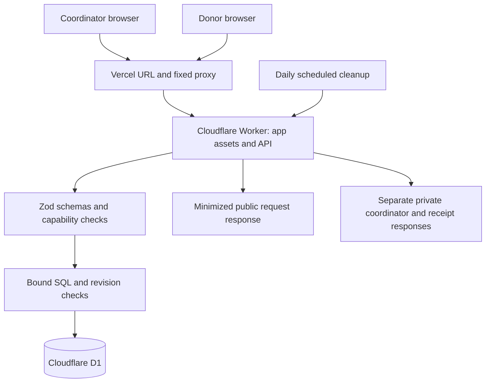
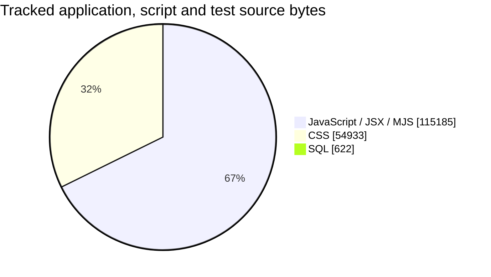

<div align="center">

# iFixit / local

### Keep the repair moving.

A community repair workbench that connects a diagnosed computer repair with a local spare-part donor, then follows the part through inspection, handover and a recorded result.

[Open the website](https://ifixit-tan.vercel.app/) · [Try the demo](#try-the-demo) · [Run locally](#run-your-own-local-copy) · [Self-host](#deploy-your-own-instance) · [Contribute](CONTRIBUTING.md)


</div>

> Independent Neighborhood Hacks 2026 student project. Not affiliated with iFixit, Inc. The MIT license covers this repository's code and does not grant rights to third-party names or trademarks.

## Start here

| Your goal | Start with |
| --- | --- |
| Explore without installing | Open the website and choose **Open demo workbench** |
| Coordinate real repairs | Choose **Create your workbench** and save your private access file |
| Offer a spare part | Open a coordinator's public request link and submit the labels on your part |
| Keep your own database | Follow the local or self-hosted setup below |
| Suggest a code change | Fork, open a pull request and wait for Adeel's review |

## The problem and the focus

A diagnosed repair can stall while a repairer looks for the right part. A donor with a spare needs a clear request, and the coordinator needs a way to check the labels and record what happened next.

This project focuses on that coordination process. A matching label is a candidate for inspection. An offer is not a completed repair. Success requires a recorded test and device-owner confirmation, entered by the coordinator.

The [research and pilot plan](docs/RESEARCH.md) separates repair-network evidence from local evidence still to be collected. No physical pilot results, interviews, waste savings or carbon savings are claimed.

## What works

- **Diagnosed requests:** one computer part per request, with model/revision, part reference, specification, repair purpose and a general staffed collection area.
- **Donor offers:** a public form, condition notes and a separate private donor receipt.
- **Label checks:** exact text comparison after case and whitespace normalization. Unknown or mismatched fields block reservation on the server.
- **Human inspection:** written inspection notes and suitability confirmation before a 48-hour reservation.
- **Handover and outcomes:** a donor code, receipt notes, test notes and owner confirmation. Failed or unresolved cases stay visible.
- **Record controls:** search, stage filters, history, record export, access-file restore, key rotation, retention renewal and workbench deletion.

The initial scope is computer memory, keyboards, cooling fans and hinges. Batteries, power supplies, medical devices and other safety-critical repairs are outside the pilot.

## The repair workflow



This diagram describes the implemented process. Label comparison does not certify compatibility, and a code does not independently prove identity or physical delivery.

## Try the demo

1. Visit [ifixit-tan.vercel.app](https://ifixit-tan.vercel.app/).
2. Choose **Open demo workbench**. You receive a separate server-backed example session.
3. Open the memory request. Compare the matching, mismatched and incomplete offers.
4. For the matching example, record a simulated inspection and confirm suitability. Reserve the offer.
5. Open its sample donor receipt. Use the example handover code to record receipt, then record a simulated test and owner confirmation.
6. Open **Outcomes** to see the explicitly labeled example result.

The demo starts with three fictional requests and three fictional offers. DEMO part references are not compatibility claims. Each demo expires after seven days unless renewed. Create a separate empty workbench for real activity.

## Use it at a repair desk

1. **Create an empty workbench.** Use a repair shop or club name.
2. **Save the private access file.** Open **Settings & access**. Keep this file private, since anyone holding it has coordinator authority. There is no email recovery.
3. **Create a diagnosed request.** Transcribe the exact labels. Public fields must not contain personal details or a private home address.
4. **Share only the public request link.** Donors submit their part labels and save their own private receipt.
5. **Review, inspect and reserve.** Inspect the actual part, record notes and confirm suitability. Reservations last 48 hours.
6. **Record collection and test.** Use the donor's code at the staffed handover. Record the test and the device owner's confirmation before recording success.

Donors can withdraw pending or reserved offers. Coordinators can release reservations, close unfilled requests and reopen unresolved repairs. A donor without a smartphone can participate through the desk.

### Access and retention

| Item | Who should hold it | Purpose |
| --- | --- | --- |
| Public request link | Potential donors | Read required labels and submit an offer |
| Private workbench access file | Authorized coordinator | Manage that workbench |
| Private donor receipt | That donor | Track or withdraw that offer and provide the handover code |
| Record export | Authorized coordinator | Export repair records without access keys or handover codes |

Real workbenches expire after 30 days unless renewed. Settings support renaming, renewing retention, restoring access, rotating the coordinator key, exporting records, leaving a device and deleting active-database records. Rotation invalidates old coordinator keys. Hosting backups may retain deleted records longer.

Access uses bearer keys rather than per-person accounts. Browser local storage is not encrypted. See [SECURITY.md](SECURITY.md) for the boundaries.

## Architecture



The Worker bundles and serves the React app as well as its API. The fixed Vercel upstream is configured by the operator. User input never selects the upstream. Browser writes accept the Worker's own origin or the exact configured `APP_ORIGIN`. Arbitrary forwarded host headers and preview aliases do not gain mutation access.

For local use, a Node HTTP adapter runs the same built Worker against a local SQLite database. You do not need Cloudflare, Vercel or an API key to run the local copy.

## Languages and tools

| Layer | Technology | Role |
| --- | --- | --- |
| Interface | JavaScript, JSX, React 19 | Workbench and donor screens |
| Styling | CSS, system fonts, Lucide icons | Responsive glossy interface, focus and reduced-motion support |
| API | JavaScript, Cloudflare Workers, Zod | Authorization, validation and workflow rules |
| Persistence | SQL, Cloudflare D1 / SQLite | Workbenches, requests and rate limits |
| Build | esbuild | Bundled app, styles and Worker |
| Development | Node.js 24, npm | Local adapter and dependency lockfile |
| Verification | Node test runner, GitHub Actions | Domain/API checks and production dependency audit |
| Hosting | Cloudflare Workers and optional Vercel proxy | App/API hosting and public URL |



Source snapshot: `3d748c9`, before this documentation update. Counts sum tracked `.js`, `.jsx`, `.mjs`, `.css` and `.sql` file sizes. They exclude documentation, JSON, dependencies and build output. This is a source-size breakdown, not runtime usage or an impact metric.

## Run your own local copy

### Requirements

- **Node.js 24** with npm. The local database adapter imports `node:sqlite`.
- Git, or a ZIP download of the source.
- A modern browser with JavaScript enabled.

### Option A: clone

```sh
git clone https://github.com/adeelfalaksher900-creator/iFixit.git
cd iFixit
npm ci
npm run build
npm test
npm run dev
```

### Option B: download a ZIP

On this repository, choose **Code → Download ZIP**. Extract it, open a terminal in the extracted folder containing `package.json`, then run:

```sh
npm ci
npm run build
npm test
npm run dev
```

Open **http://localhost:4173**. Create your own empty workbench or choose the demo. Your local records use `local.sqlite` in the project folder and are separate from the hosted website. There is no production credential to configure.

The development server listens on all network interfaces on port 4173. Use it on a trusted development machine and network. For public hosting, use the HTTPS Worker deployment below.

### Everyday commands

| Command | Result |
| --- | --- |
| `npm ci` | Install dependencies from the lockfile |
| `npm run build` | Rebuild the app and Worker into `dist/` |
| `npm test` | Run domain/API tests against the built Worker |
| `npm run dev` | Start the local server on port 4173 |

After a source change, stop the server, rebuild, run tests and restart it. There is no automatic watch/rebuild command. Keep `local.sqlite` and private access downloads out of commits.

### Troubleshooting

| Symptom | Check |
| --- | --- |
| `node:sqlite` is unavailable | Run `node --version` and switch to Node.js 24 |
| `dist/worker.js` is missing | Run `npm run build` before `npm test` or `npm run dev` |
| Port 4173 is already in use | Stop the earlier development server and restart |
| Your local workbench appears empty | Local and hosted databases are separate. Restore the access file for the same instance |
| A write returns an origin error | Use the same local hostname consistently. For a deployment, verify the exact `APP_ORIGIN` |
| Your changes are absent | Rebuild the bundle and restart the server |

## Deploy your own instance

Use your own Cloudflare account, Worker and D1 database. Your deployment must not point to this project's shared backend.

1. Install dependencies and verify the build with the commands above.
2. Copy `wrangler.example.jsonc` to a private, untracked working file named `wrangler.local.jsonc`.
3. In your copy, change the Worker `name` and D1 `database_name` to your own unique names. Keep `main` as `dist/worker.js` and the D1 binding as `DB`.
4. Sign in to your own Cloudflare account and create the database. Replace `YOUR_DATABASE_NAME` below with the name in your config.

```sh
npx wrangler login
npx wrangler d1 create YOUR_DATABASE_NAME
```

5. Put the returned database UUID in `database_id`. For a Worker-only deployment, omit `vars.APP_ORIGIN`; same-origin writes are already supported. If you use a Vercel frontend URL, set `APP_ORIGIN` to that exact HTTPS origin, with no path or trailing slash.
6. Initialize **your new database** and deploy:

```sh
npx wrangler d1 execute YOUR_DATABASE_NAME --remote --file=schema.sql --config=wrangler.local.jsonc
npm run build
npx wrangler deploy --config=wrangler.local.jsonc
```

7. Open the Worker URL printed by Wrangler. Confirm `/api/health` responds and complete a fictional request-to-outcome flow. Preserve the daily cleanup cron from the example config.
8. Optional Vercel URL: create your own Vercel project and change `vercel.json` so its fixed destination is **your** Worker URL. Replace the existing project's destination before deploying your fork. Update `APP_ORIGIN` to your Vercel production origin and redeploy the Worker. Preview aliases are not automatically authorized.

There is no paid AI service in the application. Provider free-tier quotas, account limits and future pricing still apply. A reverse proxy may aggregate multiple visitors under an IP rate limit.

Reference: [Cloudflare D1 commands](https://developers.cloudflare.com/d1/wrangler-commands/) and [Wrangler commands](https://developers.cloudflare.com/workers/wrangler/commands/).

## Project map

| Path | Contents |
| --- | --- |
| `src/app.jsx`, `src/welcome.jsx`, `src/ui.jsx` | App screens and shared controls |
| `src/worker.js` | API, access checks, persistence and cleanup |
| `src/domain.js`, `src/validation.js` | Workflow rules and input schemas |
| `src/style.css`, `src/ios.css` | Interface styling |
| `scripts/build.mjs` | Browser assets and Worker build |
| `scripts/dev.mjs`, `scripts/db.mjs` | Local HTTP and SQLite adapters |
| `schema.sql` | D1 / SQLite schema |
| `tests/` | Domain and API tests |
| `.github/workflows/check.yml` | Build, test and production dependency audit |
| `wrangler.example.jsonc`, `vercel.json` | Infrastructure examples |
| `docs/` | Research, specification and validation evidence |

## Contributions require your review

This repository stays public and MIT licensed. Anyone may read it, download it, fork it or propose a pull request. Those actions do not grant permission to alter this repository's protected default branch.

The active **Owner approval protection** ruleset targets the default branch. It restricts updates and deletion, blocks force pushes, requires a pull request, one approving review, Code Owner review, dismissal of stale approvals and resolution of review conversations. The only bypass actor is **@adeelfalaksher900-creator**, and that bypass is restricted to pull requests. No bot or app appears in the bypass list. Auto-merge is disabled. Verified on **21 October 2026**.

Adeel reviews contributions and chooses whether to merge or reject them. Even an owner-authored change goes through a pull request; the owner retains the PR-only exception needed to merge their own work. No bot approves or merges changes automatically. Current rules do not require the CI status check; the owner should inspect the **Build and verify** result before merging.

Read [CONTRIBUTING.md](CONTRIBUTING.md) for the fork-and-review process. CI uses pinned action revisions, read-only repository contents and no deployment step, `pull_request_target` workflow or automatic approval. Account security and careful review still matter. Do not upload account tokens, environment files, database files, private access files or donor receipt credentials.

## Validation, limits and next steps

The current application has **16 passing domain/API tests**, with details in [Validation evidence](docs/VALIDATION.md). They cover label gates, inspection and outcome rules, access isolation, stale revisions, expiry, withdrawal, schema checks, rate limits, management controls and the explicit proxy-origin boundary. A dependency audit reported zero known production vulnerabilities at review time.

Browser checks exercised the persistent example workflow and responsive layouts. These do not establish physical hardware compatibility, a completed neighborhood pilot, exhaustive security, full WCAG conformance or a guaranteed judging score.

The next step is a consent-based conversation with a local repairer, followed by a bounded ten-repair pilot and a real baseline. Local firsthand evidence and enrollment eligibility remain pending creator review.

## Credits and license

Built for the **Environment & Sustainability** track of Neighborhood Hacks 2026. ChatGPT/Codex assisted research, implementation, design and testing. Better Design iOS references and Lumen spacing/glass guidance informed the interface. Runtime fonts are system fonts. Dependency attribution appears in [THIRD_PARTY_NOTICES.md](THIRD_PARTY_NOTICES.md).

The edited walkthrough uses actual website captures, Hyperframes composition, synthetic English narration and captions. Gallery captures show explicitly fictional example records. The AI-generated project thumbnail is separate from those captures.

Released under the [MIT License](LICENSE).
