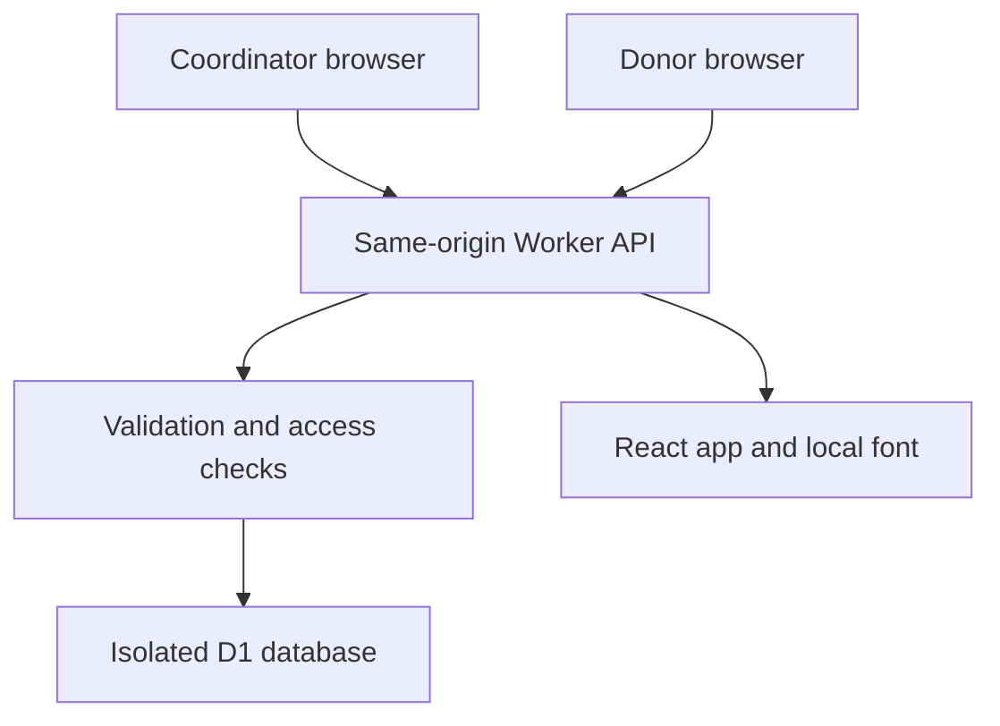

# RepairRelay

Connect a diagnosed repair with a local spare-part donor, then record the handover and repair outcome.

[Open the working app](https://repairrelay.adeelfalaksher900.workers.dev/) · [Research and pilot plan](docs/RESEARCH.md) · [Product and technical specification](docs/SPECIFICATION.md) · [Validation](docs/VALIDATION.md)

Built during Neighborhood Hacks 2026 for the Environment & Sustainability track. The deployed app uses a real API and persistent database. The example workbench contains fictional cases, fictional part references and no claimed community impact.

## Try it

1. Open the app and choose **Try an example workbench**. Each session gets its own private workbench.
2. Open **Library laptop memory**. Review the mismatch and missing-detail offers. They cannot be reserved.
3. Review the matching-label offer. Open its **example donor receipt** in another tab.
4. Record an inspection and reserve the fictional part. Copy the code from the donor receipt and record handover.
5. Record the test result and owner confirmation. The Outcomes page now counts one example repair.
6. For your own records, choose **Start a real workbench**. It begins empty.

The interface never treats a matching string as a safety certification. A competent technician must inspect and test the actual part. Demo actions are demonstrations, not real inspection evidence.

## What works

- Coordinator workbenches, separate public request pages, and private donor receipts.
- Diagnosed requests for computer memory, keyboards, cooling fans and hinges.
- Exact comparisons of device model/revision, part number and specification. Case and repeated spaces normalize. Punctuation, revisions and electrical values remain significant.
- Missing fields and mismatches block reservation. Physical inspection notes and an explicit confirmation are required.
- A single active reservation per request, a 48-hour collection window, donor withdrawal and coordinator release.
- Donor-only handover code, physical receipt notes, test result and owner-confirmed repair completion.
- Recorded unsuccessful outcomes, request closure/reopening and chronological repair history.
- Persistent server records, access-file restore, private record exports, search and stage filters.
- Responsive layout, keyboard-accessible native forms, Urdu navigation/RTL, English technical labels and detailed pilot guidance. Full Urdu translation and user research remain future work.

## Architecture



The Worker serves the app and API from the same origin. There are no paid APIs, analytics scripts, external fonts at runtime or AI compatibility guesses. Zod validation stays on the server. SQLite prepared statements bind all user data. Revision checks reject stale or concurrent writes rather than silently overwriting a donor offer.

## Run locally

Node.js 24 is required for the local SQLite adapter.

```sh
npm ci
npm run build
npm test
npm run dev
```

Open `http://localhost:4173`. The local database is `local.sqlite`, excluded from source control. Production uses the Cloudflare D1 binding `DB`, not this adapter.

## Deploy your own

1. Create a Cloudflare D1 database and run `schema.sql`.
2. Build with `npm run build`.
3. Deploy `dist/worker.js` as an ES module Worker, with compatibility date `2026-10-19` and the D1 binding named `DB`.
4. Enable its workers.dev route and add a daily cron trigger for expired-record cleanup.

`wrangler.example.jsonc` documents the configuration. Supply your own database ID. No account token or production access key belongs in source control. The architecture fits Cloudflare's published free allowances for a small pilot. Account-wide usage still applies; no paid upgrade is required by this code.

## Access and limitations

A random 256-bit capability key grants coordinator access. A separate key grants access to one donor receipt. Server records store key hashes. Access files are bearer credentials: keep them private. There is no identity check, credential revocation, email recovery or independently verified technician status in this pilot. Browser local storage is not encrypted.

Demo workbenches expire after 7 days. Real pilot workbenches expire after 30 days. Expired records are inaccessible and removed by daily application cleanup, subject to the host's backup retention. Download exports first. Do not enter names, home addresses, phone numbers, serial numbers or private details in public request fields.

This version has no production user pilot, catalog integration, image-based identification, automated safety assessment, payment processing or carbon accounting. See [SECURITY.md](SECURITY.md) for boundaries.

## Evidence and authorship

The problem is supported by primary repair-network research. Local firsthand observations and partner validation are still pending. No fabricated interviews, users, repair successes or environmental savings are presented.

ChatGPT/Codex assisted research, implementation, review and testing. React, Lucide, Manrope, Zod, esbuild and Prettier are credited in [THIRD_PARTY_NOTICES.md](THIRD_PARTY_NOTICES.md). The team should review all submission claims and confirm hackathon eligibility before final submission. Video and promotional images are intentionally pending creator review.

MIT license.
