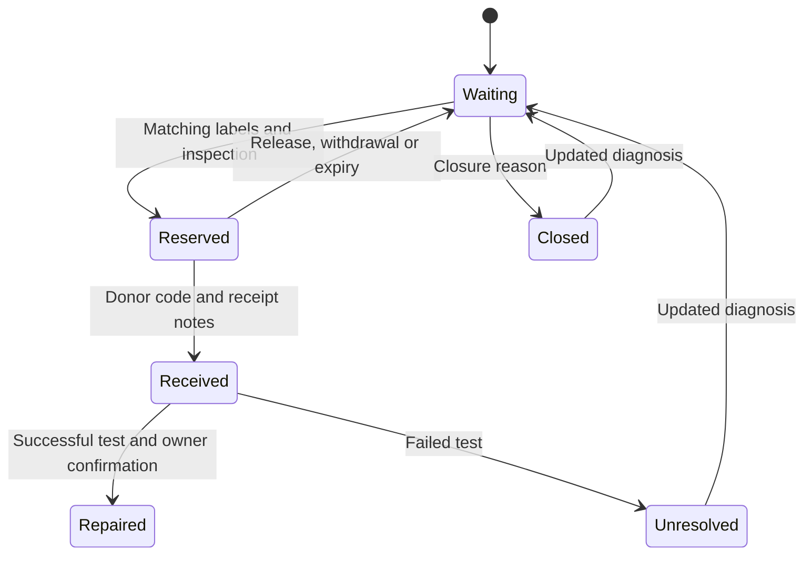

# iFixit / local product and technical specification

## Product goal

Help one repair coordinator turn a diagnosed computer-part need into an inspected donor part and a recorded repair result. The main screen answers: which repairs need attention next?

Primary users: competent repairer/coordinator, local donor, device owner assisted by the coordinator. A person without a smartphone participates through the staffed repair desk. The app does not independently verify a technician's competence or the owner's confirmation.

## Product requirements

| Requirement | Implemented behavior |
| --- | --- |
| Define a real need | Required diagnosis, purpose, model/revision, exact part reference, specification and collection area |
| Find candidates | A public per-request link and private offers with label details and test notes |
| Preserve uncertainty | Match, mismatch or unknown for each field; mismatches and missing fields block reservation |
| Human decision | Explicit physical inspection attestation and at least 15 characters of inspection notes |
| One active allocation | One selected offer per request with optimistic concurrency checks |
| Time-bound collection | 48-hour reservation, release, automatic expiry, donor withdrawal |
| Record handover | A 12-character code from the donor's private receipt plus receipt notes |
| Record result | Received part before completion; test description; owner confirmation for successful repair |
| Honest reporting | Offers and handovers never counted as repairs; failed outcomes retained |
| Portability | Private coordinator/receipt files and repair-record exports |
| Data minimization | No required names, email, phone, address, identity document, serial number or location permission |

Pilot caps: 50 requests per bench, 20 offers per request, 10 bench creations/hour/IP, 30 offer/receipt mutations/hour/IP and 150 coordinator mutations/hour/IP. These are abuse controls, not service-level guarantees. One physical part offered against several requests is still a coordinator responsibility; this version is not a global inventory system.

## Workflow and states

The public request contains only the need and current stage. It never contains donor aliases, offers, codes, receipt keys or coordinator notes. Donor receipts reveal only that donor's offer. Coordinator reads omit handover codes and real donor keys. Example fixtures deliberately provide an example receipt link so a judge can test both roles.

## Interaction design

Minimal glossy iOS-style design selected by the creator. The English-only interface uses system fonts, white working surfaces, explicit frosted navigation/sheets, blue actions, a floating sidebar and segmented stage filters. Status uses distinct colors plus text. Motion is limited to transform/opacity and respects reduced-motion preferences. Better Design iOS references and Lumen material/spacing guidance informed the implementation.

The screen's distinctive element is the part comparison: required and offered labels stay beside each other. Repair history and the four-stage strip expose what is still unproven. Metrics derive from the same request rows rendered in the table. No vanity charts or invented impact totals appear.

Desktop grid: 228px sidebar + remaining workspace. The work sheet uses equal internal gutters. Detail splits into required-part and sharing panels. At tablet widths the sidebar folds. Phone navigation opens from the menu; table rows become stacked identities and status. Native forms have persistent labels, visible focus and validation. Native dialog semantics trap focus and Escape closes dialogs.

The interface, forms and validation are English-only as requested. Assistive-technology testing with intended users remains a next step.

## Technical design

React renders the UI. esbuild bundles the app, CSS and one local font into an asset map. The Cloudflare ES module Worker serves these static assets and the API. This avoids a second origin, CORS configuration and external runtime dependencies. D1 is a dedicated database for this project. Existing unrelated account resources are not used for application data.

### Data model

- `benches`: ID, coordinator key hash, display name, demo flag, creation and expiry timestamps.
- `repairs`: ID, owning bench ID, revision integer, JSON record with request fields, offers, selected offer, outcome and history.
- `limits`: hourly hash key, count and expiry. IP hashes rotate by hour and operation scope.

User input reaches SQL only through bound parameters. Bench ownership is enforced by the API, not a client filter or database row-level-security claim. A JSON record keeps single-request state changes atomic with `UPDATE ... WHERE id=? AND revision=?`. A zero-row update returns HTTP 409. This prevents lost updates and double allocation within a request. It does not offer cross-request inventory locking.

### API

| Method | Route | Required authority |
| --- | --- | --- |
| POST | `/api/benches` | Rate-limited public creation |
| GET | `/api/benches/:id` | Coordinator capability key |
| POST | `/api/benches/:id/requests` | Coordinator key and diagnosed request schema |
| GET | `/api/requests/:id` | Public sanitized view |
| POST | `/api/requests/:id/offers` | Public, consent and strict schema |
| POST | `/api/requests/:id/action` | Owning coordinator, revision and valid transition |
| GET | `/api/receipts/:request/:offer` | That donor's receipt key |
| POST | `/api/receipts/:request/:offer` | That donor's key; withdraw pending/reserved offer |

Failures use clear 400/401/403/404/409/410/413/415/429 responses. Client forms retain their text after save failures. Refresh retrieves current server state. The app requires connectivity for server operations and makes no offline-synchronization claim.

## Security and data lifecycle

Random keys contain 256 bits of entropy. SHA-256 digests are stored server-side. Keys travel in authorization headers. Newly created donor receipt links use a fragment and remove it from browser history after capture; fragments do not reach the HTTP server. On shared devices, users should export private access then leave the device.

The API rejects cross-origin writes, requires JSON, limits streamed bodies to 16KB and validates field lengths/enums. Responses prevent framing and content sniffing, suppress referrers and use a restrictive same-origin content security policy. The app imports no third-party runtime scripts. Mutation APIs and private reads use `Cache-Control: no-store`.

Demo expiry is 7 days, pilot expiry 30 days. Expired workbenches stop responding before deletion. Daily cleanup removes expired benches, cascading their repairs, and stale limit entries. Hosting backup retention is outside application cleanup. Keys are not revocable in this first version; loss of a private file has no email recovery.

## Acceptance criteria

- A donor can offer through a public link without coordinator authority.
- Another bench's key cannot read or mutate a bench.
- A coordinator cannot read a real donor receipt using only the coordinator key.
- A mismatched/unknown offer cannot reserve, including direct API calls.
- Two competing revisions cannot both win.
- Wrong donor code cannot record receipt.
- Successful completion requires received status, a meaningful test and owner confirmation.
- Withdrawal and expiry reopen the request.
- Exports exclude keys/codes except explicit private access/receipt files.
- Empty and failed states remain usable; no impact appears before a qualifying outcome.

## Version 2 owner controls and delivery

The public URL is https://ifixit-tan.vercel.app/ (Vercel proxy to a fixed Worker upstream). `APP_ORIGIN` authorizes that exact production browser origin. Arbitrary forwarded hosts do not authorize writes. Workbench management adds rename, 30-day renewal, atomic coordinator-key replacement and owner-confirmed active-database deletion. Every management operation authenticates the owning capability. No per-person accounts or email recovery are claimed. New users start with an empty workbench and receive an access-file reminder; legacy example data remains labeled when explicitly restored. Source: https://github.com/adeelfalaksher900-creator/iFixit .
